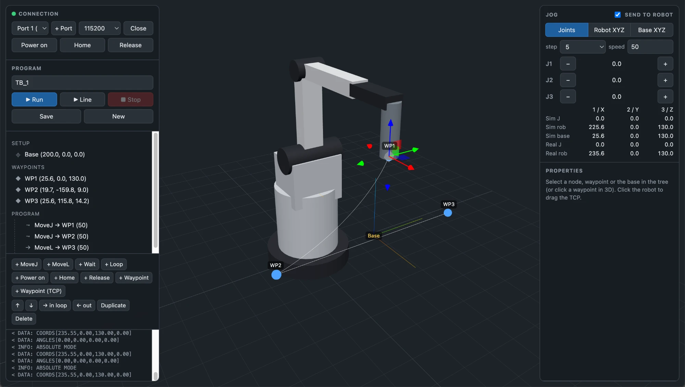
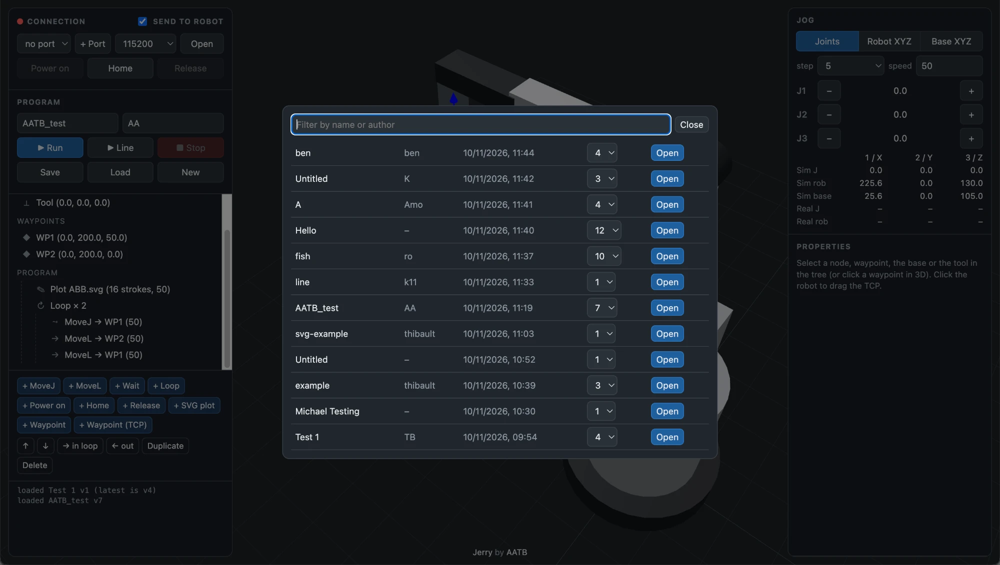

# Jerry

Jerry, a simple online/offline programming environment for the [Elephant Robotics](http://elephantrobotics.com/) ultraArm P340, used during a workshop at [Hong Kong Design Institute](https://hkdi.edu.hk/). This tool was developed to allow a whole class to experiment individually virtually on their projects, and connect periodically to real hardware, loading their own files easily from a shared library.

## Features

- Joint and Cartesian jogging, by buttons or by dragging the TCP gizmo
- TCP and base coordinate systems; tool offset from the flange (default: TCP at the flange)
- Waypoints: capture from the TCP, edit numerically or drag in 3D
- Program tree: MoveJ, MoveL, wait, loops, functions (define a subprogram once, call it anywhere), power on, home, release, set digital output (GPIO / fan), PWM, gripper
- SVG plotting: load an SVG, place it with an anchor pose, set scale, approach height and speed; optionally call a function before every stroke (e.g. dip a brush in ink)
- Run on the virtual robot for preview, or on the real arm via Web Serial
- Path preview of the TCP trajectory
- Programs saved to a flat-file db, reloaded via a URL GUID, with versioning, to allow easy save/load from different machines (personal laptops for offline programming -> save -> on machine that is connected to real hardware load their own file -> run)

*Left pane: hardware control, scene save/load/new, base/TCP offset, program tree and editor. Right pane: jogging, node properties.*

*Saved scenes show up in a shared library to easily load from a different machine with actual hardware, allowing easy prototyping offline, save and load for online playback.*

## Program nodes

A program runs its nodes from top to bottom. Each node waits for the previous one to finish. **Run** runs the whole program (forever if *loop program* is checked); **Run line** runs only the selected node.

| Node | What it does |
|---|---|
| **MoveJ** | Moves to a waypoint by turning all joints together. The fastest way there, but the TCP path is curved. |
| **MoveL** | Moves to a waypoint in a straight line. Refused if the line leaves the workspace: add a waypoint in between or use MoveJ. |
| **Wait** | Pauses for a set time in ms. |
| **Loop** | Runs the nodes inside it a set number of times. |
| **Function** | Defines a named subprogram. Its nodes are skipped where they stand and only run when called. |
| **Call** | Runs a function at this point. Define a procedure once and call it as often as needed. |
| **Power on** | Locks the servos so the arm holds its position. |
| **Home** | Sends the arm to its home position (all joints at 0). |
| **Release** | Releases the servos: the arm can be moved by hand. |
| **SVG plot** | Draws an SVG: for each stroke, moves above its start, lowers by the approach height, follows the stroke, then lifts. Optionally calls a function before every stroke (e.g. dip a brush in ink). |
| **Set DO** | Switches a digital output on or off: GPIO (suction pump) or fan. |
| **PWM** | Sets the PWM output, 0–255 (e.g. laser power). |
| **Gripper** | Moves the gripper to a position (0 = closed, 100 = open), calibrates it, or releases it. |

Add nodes with the blue buttons; they go after the selected node, or inside it if it is a loop or function. **→ in** / **← out** move a node into the loop or function above, or back out.

## Run

Deploy on a LAMP server with HTTPS to have a simple personal virtual programming environment that can directly control the ultraArm P340 with Web Serial.

- **Production:** copy the folder to a LAMP server (PHP 7.4+) with HTTPS. `db/` must be writable by Apache.
- **Local:** serve the folder with any local PHP stack such as [MAMP](https://www.mamp.info), with HTTPS enabled (Web Serial needs HTTPS or localhost). `db/` must be writable.

The robot connects over Web Serial, which needs Chrome or Edge on HTTPS or localhost. Click **+ Port**, pick the arm's USB serial port, then **Open** (115200 baud).

## Files

| | |
|---|---|
| `index.html` | UI layout and styles |
| `js/main.js` | program tree, properties, jogging, executor, save/load |
| `js/scene.js` | three.js scene, arm model, waypoints, gizmo, path preview |
| `js/kin.js` | forward/inverse kinematics and arm dimensions |
| `js/serial.js` | Web Serial + ultraArm G-code protocol |
| `js/svg.js` | SVG → simplified pen strokes in mm |
| `api.php` | storage: `db/<guid>/<version>.json` |
| `results/` | workshop results slideshow: images dropped in `results/img/` are shown three at a time, multiplied on top of each other |

## License

MIT © AATB GmbH. See [LICENSE](LICENSE).

---

Developed with [Claude Code](https://claude.com/claude-code).
